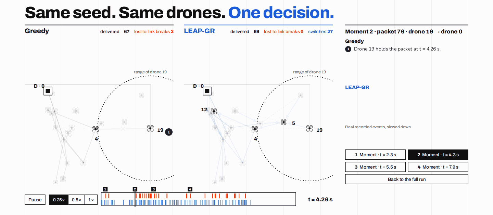
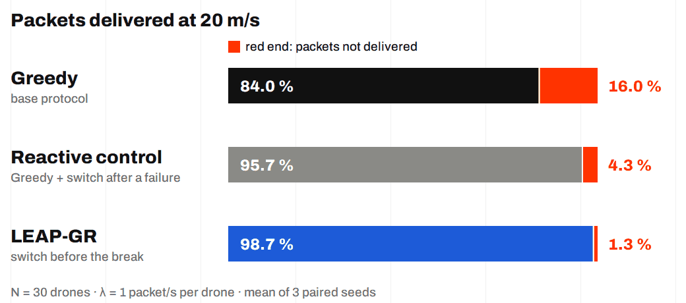
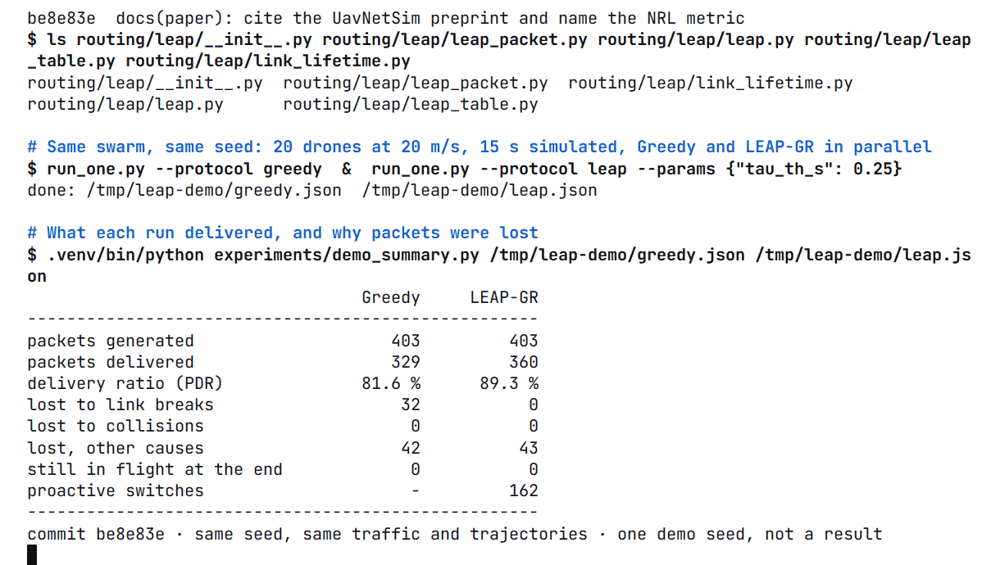

<h1 align="center">LEAP-GR</h1>

<p align="center"><b>Predicting link breaks in UAV swarms</b><br>
Greedy geographic routing that changes next hop <i>before</i> the radio link fails.</p>

<p align="center">
  <a href="https://github.com/Jozziiff/leap-fanet-routing/actions/workflows/ci.yml"></a>
  
  
  
</p>

<p align="center">
  <a href="https://github.com/Jozziiff/leap-fanet-routing/releases/tag/v1.0.0"><b>Paper (PDF)</b></a> · <a href="docs/methodology.md"><b>Methodology</b></a> ·
  <a href="docs/reproducing.md"><b>Reproduce</b></a> · <a href="slides/"><b>Slides</b></a>
</p>

<p align="center">
  
</p>

<p align="center"><i>One packet, two recorded runs, same seed. Greedy (left) sends it to drone 4, which has
already left range, and loses it. LEAP-GR (right) sees the dead link and switches to drone 5.</i></p>

## The idea

In a swarm of drones, neighbours fly out of range all the time. Greedy forwarding sends each packet to the
neighbour closest to the destination, and that neighbour is often the one about to leave. We first measured
exactly why seven existing FANET protocols lose packets, then built a protocol around what we found.

The diagnosis classifies every failed reception as a link break (receiver out of range) or a collision.
Since the MAC retries five times, collisions almost never cost a packet in the end, while link breaks cause
most of the losses.

LEAP-GR (Link-Expiration-Aware Predictive Greedy Routing) targets those breaks. Each node extrapolates its
neighbours' positions from their hello messages and estimates how long each link will last. If Greedy's pick
is about to break, it forwards to a neighbour that will stay in range.

All protocols run with the same MAC, seeds and trajectories. A reactive control, which switches neighbour
after a failed attempt, separates the gain from prediction from the gain from switching at all.

## Results



- Link breaks cost Greedy 4.1 % of its packets at 5 m/s and 16.0 % at 20 m/s.
- LEAP-GR delivers more than Greedy in 9 of 11 configurations (paired, 95 % CI), by up to 14.7 points.
- Prediction beats the reactive control by 0.9 to 3.0 points at high speed and density. It loses at 5 m/s
  and when the network is saturated, and the [article](https://github.com/Jozziiff/leap-fanet-routing/releases/tag/v1.0.0) explains why.
- 98.4 % of LEAP-GR's switches avoid a neighbour that, by its last hello, had already left range but was still
  in Greedy's neighbour table. Most of the gain comes from not trusting stale neighbours.

Unless stated otherwise: 30 UAVs, 1 packet/s per UAV, mean of 3 paired seeds. All figures are in
[`figures/`](figures/).

## How it works

Hello messages carry each UAV's position, velocity and a timestamp. For each neighbour, a node computes the
remaining link lifetime τ̂: the time until their distance exceeds 0.9 R_max (R_max = 249.3 m, derived from
the simulator's radio parameters). Then, per packet and per hop:

1. Take Greedy's choice, the neighbour closest to the destination.
2. If its τ̂ ≥ τ_th (0.25 s), forward to it, exactly like Greedy.
3. Otherwise forward to the neighbour with the most progress among those with τ̂ ≥ τ_th, or keep Greedy's
   choice if there is none.

The MAC is not modified. On an ACK timeout it calls the routing layer's `penalize` hook, which lets
LEAP-GR redirect the remaining attempts. The protocol lives in [`routing/leap/`](routing/leap/).

## Quickstart

You need [uv](https://docs.astral.sh/uv/). It installs Python 3.12 and the pinned dependencies.

```bash
git clone https://github.com/Jozziiff/leap-fanet-routing.git
cd leap-fanet-routing
uv sync
uv run python experiments/run_one.py --protocol leap --params '{"tau_th_s": 0.25}' \
    --n 10 --speed 20 --sim-time-s 10 --traffic-start-s 1 --traffic-end-s 9 --out quick.json
```

This simulates 10 s of a 10-UAV swarm in one or two minutes. `quick.json` holds the configuration, the code
version and the metrics: delivery ratio, delay, loss causes, route recomputations, LEAP events. Swap `leap`
for `greedy`, `grad`, `dsdv`, `opar`, `q_routing`, `qgeo` or `qfanet` to run another protocol.

To run Greedy and LEAP-GR side by side on the same seed, as in the defense demo:

```bash
experiments/demo.sh
```

<details>
<summary>What the demo prints</summary>
<br>

<br>
One seed, for illustration. The results above come from the full sweeps. A side-by-side video of the
two protocols is attached to the [release](https://github.com/Jozziiff/leap-fanet-routing/releases/tag/v1.0.0).
</details>

## Reproducing the experiments

```bash
make test       # pytest, about 7 minutes
make figures    # every figure and table from the committed results, in seconds
```

The raw results of all 401 runs (Exp A to E) are attached to the [release](https://github.com/Jozziiff/leap-fanet-routing/releases/tag/v1.0.0) as `results-raw.zip`.
[`docs/reproducing.md`](docs/reproducing.md) has the commands to rebuild the tables from them, or to rerun
the simulations: one YAML config per experiment, a resumable sweep driver that can split the work across
machines, and bit-identical results for the same seed on any machine.

## Repository layout

| Path | Content |
|---|---|
| [`routing/leap/`](routing/leap/) | LEAP-GR: link lifetime, hello packet, neighbour table, protocol |
| [`instrumentation/`](instrumentation/) | observe-only hooks and the recorder behind the loss attribution |
| [`experiments/`](experiments/) | single-run runner, sweep driver, configs, demo |
| [`analysis/`](analysis/) | aggregation, paired statistics, figures |
| [`tests/`](tests/) | pytest suite (`uv run pytest`, slow golden tests with `-m slow`) |
| [`paper/`](paper/) | the article (LaTeX, IEEEtran) |
| [`slides/`](slides/) | the defense slides in HTML, with the recorded demo and its replay |
| [`docs/`](docs/) | [architecture](docs/architecture.md), [methodology](docs/methodology.md), [reproduction](docs/reproducing.md), specification, decision log, lab notebook, verified simulator facts |
| everything else | UavNetSim-v1 v1.0.1, with our changes listed in [`PATCHES.md`](PATCHES.md) |

Our changes to the simulator do nothing unless switched on: a golden test checks that, with them off, the
metrics are bit-identical to the unmodified simulator.

## Limitations

Free-space channel without fading, Gauss–Markov mobility only, 30-s runs, three seeds per configuration,
energy depletion disabled, and the destination's position is known to the source (as for Greedy). OPAR on
this platform uses the true positions of all UAVs, so it serves as a reference with global knowledge.

## Authors

Built by [Youssef Hamdani](https://github.com/Jozziiff) and Rayen Hamza as Projet 06 of the
*Futurs Réseaux Mobiles* course (RT5, INSAT, 2026/2027), supervised by Dr Mériem Afif.

The simulator is [UavNetSim-v1](https://github.com/Zihao-Felix-Zhou/UavNetSim-v1) by Zihao Zhou *et al.*
([paper](https://arxiv.org/abs/2507.09852), MIT license). Its original README is kept as
[`README_UPSTREAM.md`](README_UPSTREAM.md) and its license as [`LICENSE-UPSTREAM`](LICENSE-UPSTREAM).

## Citation

If this work helps yours, GitHub's "Cite this repository" button (from [`CITATION.cff`](CITATION.cff)) gives
the reference. Our code is under the [MIT license](LICENSE).
