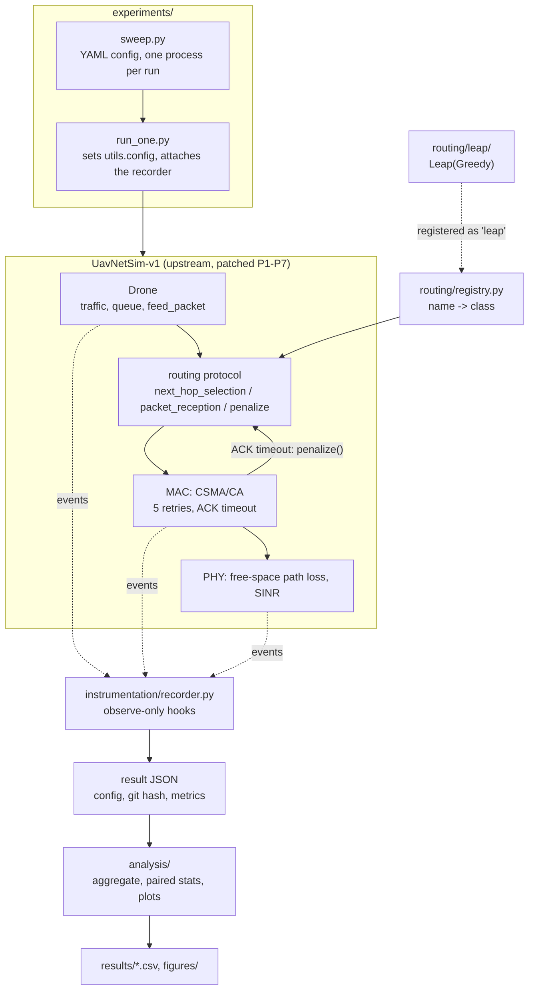

# Architecture

This repository is UavNetSim-v1 v1.0.1 (a SimPy discrete-event simulator of a UAV swarm) with three things
added: a routing protocol, an observer that explains every lost packet, and the tooling to run and analyse
experiments. The upstream tree is the first commit; every later change to an upstream file is in
[`PATCHES.md`](../PATCHES.md).

## Where our code plugs in

| Piece | What it does | Upstream change it needs |
|---|---|---|
| [`routing/registry.py`](../routing/registry.py) | maps a protocol name to its class, so a run can pick any protocol | patch P2: the drone installs `registry.get(config.ROUTING_PROTOCOL)` instead of a hard-coded `Dsdv` |
| [`routing/leap/`](../routing/leap/) | LEAP-GR, a subclass of upstream Greedy | none |
| [`instrumentation/`](../instrumentation/) | records generation, decisions, transmissions, receptions (with their SINR), drops and deliveries | patch P6: `if hooks.REC is not None: hooks.REC.<event>(...)` in the drone, MAC, PHY and metrics |
| [`experiments/run_one.py`](../experiments/run_one.py) | writes the run's settings into `utils.config` before importing the simulator | patches P2-P4 turn upstream literals (protocol, speed, traffic rate) into config values with upstream defaults |

The recorder only observes. With it attached and every setting at its upstream value, the metrics are
bit-identical to the unmodified simulator (test T4, `uv run pytest -m slow`).

## LEAP-GR

`Leap` inherits everything from `Greedy` and changes three things:

- [`leap_packet.py`](../routing/leap/leap_packet.py): the hello message also carries the sender's velocity
  and the time its position was sampled (128 extra bits).
- [`leap_table.py`](../routing/leap/leap_table.py): the neighbour table keeps those fields and dead-reckons
  each neighbour's position to the current time.
- [`leap.py`](../routing/leap/leap.py): `next_hop_selection` takes Greedy's pick, computes its remaining link
  lifetime with [`link_lifetime.py`](../routing/leap/link_lifetime.py), and switches to a safer neighbour
  when that lifetime is below `tau_th_s`. `penalize`, which the upstream MAC already calls on every ACK
  timeout, lets it redirect the remaining attempts.

The same class runs every variant of the ablation through its parameters: `repair: off` is LEAP-select,
`repair: predictive` is LEAP-GR, and `tau_th_s: 0, repair: reactive` is the reactive control. With
`tau_th_s: 0` and no extra hello bits it reproduces Greedy bit for bit (test T3). Design choices and their
reasons are in [`DECISIONS.md`](DECISIONS.md) (D-012).

## Constraints the code respects

- One simulation per fresh Python process: `utils.config` is module state, global ID counters are never
  reset, and `MAX_TTL` is computed at import.
- The MAC is identical in every comparison; LEAP-GR only uses routing-layer hooks.
- The simulator's polling intervals (5 µs inbox, 10 µs queue) are never changed, because they change
  behaviour.
- Time inside the simulator is in microseconds and distance in metres; our variables carry their unit
  (`t_us`, `tau_s`, `d_m`).
